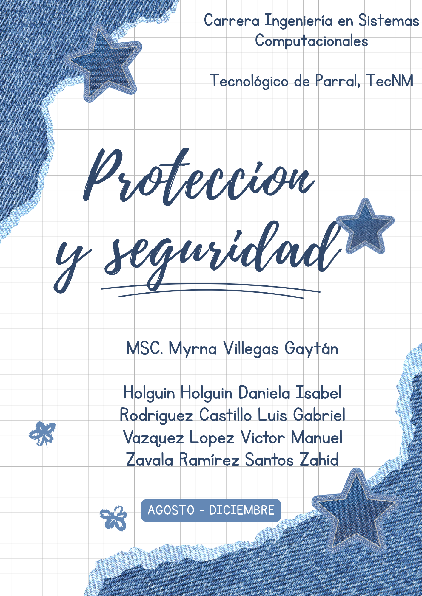

# PaginaWebSO
La página tiene como objetivo presentar información sobre los principales conceptos, mecanismos y herramientas que permiten proteger los sistemas informáticos y mantener segura la información.
# ProteccionYSeguridad

# Sistemas Operativos

**Nombre:** Daniela Isabel Holguín Holguín
**Nombre:** Luis Gabriel Rodriguez Castillo
**Nombre:** Victor Manuel Vazquez Lopez
**Nombre:** Santos Zahid Zavala Ramirez

**Carrera:** Ingeniería en Sistemas Computacionales

**Semestre:** 3.er semestre

**Materia:** Sistemas Operativos

**Docente:** Mtra. Myrna Villegas Gaytán

## Descripción
Este repositorio contiene una pagina web en html
